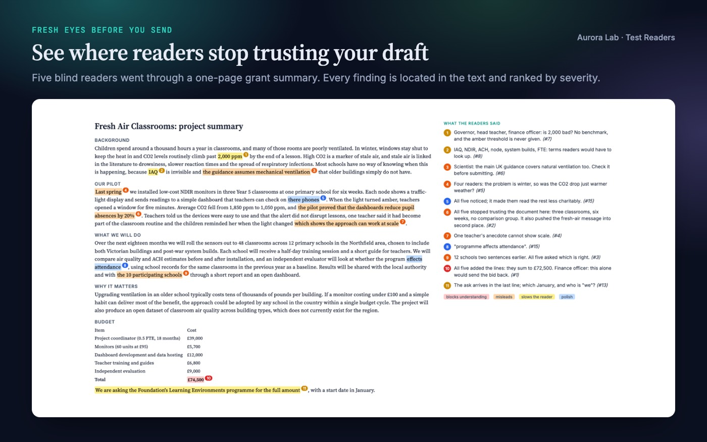
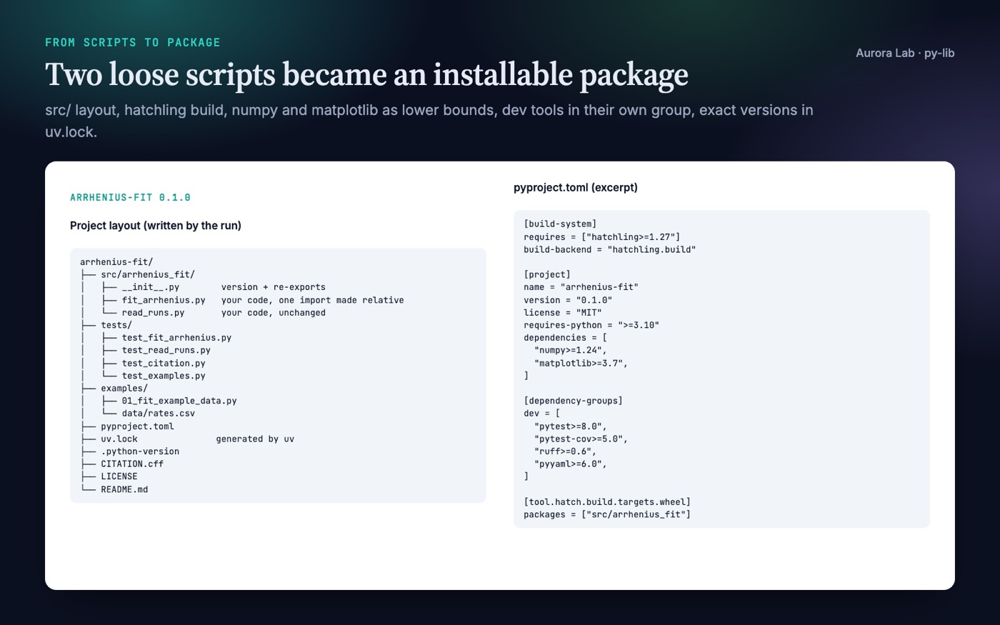

# Aurora Lab skills for researchers

Two free agent skills for the parts of research work that nobody reviews until it is too late: how a
draft reads to someone who has never seen it, and whether the code behind a paper can be installed and
cited. Both are plain `SKILL.md` skills, so they work in Claude Code, Codex, Cursor, Gemini CLI and any
other agent that loads skills. This repository is also a Claude Code plugin marketplace with one plugin,
`aurora-lab`, that contains both skills.

| Skill | What it does | Docs |
|---|---|---|
| **Test Readers** (`test-readers`) | Gives your draft, and nothing else, to blind reader personas (Newcomer, Expert, Editor, Decision-maker, Skimmer), checks whether your intended message landed, and returns a tactful report that ranks every issue by severity and pairs it with a fix or a question. | [Docs](https://the-aurora-lab.github.io/skills/test-readers/) |
| **Citable Python Packages from Research Code** (`py-lib`) | Turns loose research scripts, or just an idea, into an installable Python package (uv, hatchling, ruff, pytest, `src/` layout) with `CITATION.cff`, a README with "How to cite", and a committed `uv.lock`. Your code is copied in unchanged; anything risky is flagged, not rewritten. | [Docs](https://the-aurora-lab.github.io/skills/py-lib/) |

## Test Readers



Five blind readers went through a one-page grant summary in about two minutes. They found a budget
that did not add up, a pilot result claimed as proof and a school count that changed between
paragraphs, and showed that the intended message had been crowded out. The draft itself was left
untouched. Example prompts:

- "Get fresh-reader feedback on `proposal.md` before I send it to the panel."
- "Will this email to the department head land? The ask is a second server by March."

## Citable Python Packages from Research Code



Two analysis scripts became the `arrhenius-fit` package: both scripts moved in unchanged except one
import, ten passing tests (including one that keeps `CITATION.cff` valid and in step with the
version), a runnable example, and a list of four things in the code worth a second look. Example
prompts:

- "Package `fit.py` and `io_utils.py` into a library I can cite in my paper."
- "Add a CITATION.cff and a How to cite section to this repo."

## Install

### Claude Code (plugin marketplace)

In a Claude Code session:

```text
/plugin marketplace add the-aurora-lab/skills
/plugin install aurora-lab@aurora-lab-skills
```

Or from your shell:

```bash
claude plugin marketplace add the-aurora-lab/skills
claude plugin install aurora-lab@aurora-lab-skills
```

The skills then appear as `/aurora-lab:test-readers` and `/aurora-lab:py-lib`, and Claude also picks
them up on its own when a request matches.

### Any agent, with skills.sh

```bash
npx skills add the-aurora-lab/skills
```

The installer asks which skills and which agents (Claude Code, Codex, Cursor, Gemini CLI and many
more) to install for. Add `--skill test-readers` or `--skill py-lib` to install one.

### Gemini CLI extension

```bash
gemini extensions install https://github.com/the-aurora-lab/skills
```

### Manual copy (Codex, Cursor, Gemini CLI and others)

Each skill is a self-contained folder under `skills/`. Copy the folder into your agent's skills
directory, for example:

```bash
git clone https://github.com/the-aurora-lab/skills aurora-lab-skills
mkdir -p ~/.agents/skills
cp -R aurora-lab-skills/skills/test-readers aurora-lab-skills/skills/py-lib ~/.agents/skills/
```

| Agent | Project folder | User folder |
|---|---|---|
| Claude Code | `.claude/skills/` | `~/.claude/skills/` |
| Codex | `.agents/skills/` | `~/.agents/skills/` |
| Cursor | `.agents/skills/` | `~/.cursor/skills/` |
| Gemini CLI | `.agents/skills/` | `~/.gemini/skills/` |

## What the skills run and access

- **Test Readers** has no scripts and makes no network calls. It reads the draft you point it to and
  writes one report (in `research/reviews/` if you keep a `research/` folder, otherwise next to the
  draft). It never edits the draft unless you ask.
- **Citable Python Packages** has no bundled scripts. It writes the package files in your project and
  runs `uv`, `ruff` and `pytest` locally. The only network access is the first `uv sync`, which
  downloads your package's dependencies from PyPI; the agent asks before it runs. It never publishes
  anything to GitHub, Zenodo or PyPI: those steps are a checklist for you.

Neither skill collects or sends any data.

## More Aurora Lab skills

The paid skills below are sold on [Agensi](https://www.agensi.io/creators/aurora-lab), and the four
bundles are also available as direct zip downloads you keep (at twice the Agensi price) via [Gumroad](https://theauroralab.gumroad.com) or Polar
(all buy options on one page: [the-aurora-lab.github.io/bundles](https://the-aurora-lab.github.io/bundles/)). They are
not part of this repository; each has a public documentation page. Updates and new skills:
[@theauroralab on X](https://x.com/theauroralab).

| Skill | What it does | Price | Docs | Get it |
|---|---|---|---|---|
| Paper Figures: Publication-Ready Figures | Journal-ready figures that never overstate the data, in a colour-blind-safe style | $9 | [Docs](https://the-aurora-lab.github.io/skills/paper-figures/) | [Agensi](https://www.agensi.io/skills/paper-figures-publication-ready-figures) |
| Figure Editor: Multi-Panel Journal Figures from Your Images | One labelled multi-panel figure at exact journal width, with a caption draft | $9 | [Docs](https://the-aurora-lab.github.io/skills/figure-editor/) | [Agensi](https://www.agensi.io/skills/figure-editor-multi-panel-journal-figures-from-your-images) |
| Figure Audit: Catch Figure Problems Before Reviewers Do | Ranked figure findings with a minimal fix and a redesign, both redrawn | $9 | [Docs](https://the-aurora-lab.github.io/skills/figure-audit/) | [Agensi](https://www.agensi.io/skills/figure-audit-catch-figure-problems-before-reviewers-do) |
| Table Design: Publication-Ready Results Tables | A results CSV turned into booktabs LaTeX and Markdown tables, rounded to match | $5 | [Docs](https://the-aurora-lab.github.io/skills/table-design/) | [Agensi](https://www.agensi.io/skills/table-design-publication-ready-results-tables) |
| Bifurcation Diagrams: Publication-Ready Figures from ODEs | Bifurcation diagrams computed from your equations, every branch checked by simulation | $9 | [Docs](https://the-aurora-lab.github.io/skills/bifurcation-diagrams/) | [Agensi](https://www.agensi.io/skills/bifurcation-diagrams-publication-ready-figures-from-odes) |
| Claim Check: Every Result Backed by Its Data | Every sentence about a result checked against the results file it cites | $12 | [Docs](https://the-aurora-lab.github.io/skills/claim-check/) | [Agensi](https://www.agensi.io/skills/claim-check-every-result-backed-by-its-data) |
| Scientific Voice: Submission-Ready Prose, English & Spanish | Tighter scientific prose in English and Spanish, with numbers and terms unchanged | $12 | [Docs](https://the-aurora-lab.github.io/skills/scientific-voice/) | [Agensi](https://www.agensi.io/skills/scientific-voice-submission-ready-prose-english-spanish) |
| Journal House Style: Fit Any Venue's Author Guidelines | A sourced venue profile from current guidelines, then an audit and a cut to fit | $12 | [Docs](https://the-aurora-lab.github.io/skills/journal-house-style/) | [Agensi](https://www.agensi.io/skills/journal-house-style-fit-any-venue-s-author-guidelines) |
| Modelling Paper: From Model Results to a Full Draft | A modelling paper co-written from your model, with derivations checked against your code | $12 | [Docs](https://the-aurora-lab.github.io/skills/modelling-paper/) | [Agensi](https://www.agensi.io/skills/modelling-paper-from-model-results-to-a-full-draft) |
| Research Software: Correct, Tested, Reproducible Code | Leakage, unseeded randomness and swallowed errors found and fixed, results pinned by tests | $12 | [Docs](https://the-aurora-lab.github.io/skills/research-software/) | [Agensi](https://www.agensi.io/skills/research-software-correct-tested-reproducible-code) |
| Instructions Writer: READMEs That Work on the First Try | A README rewritten from your project's facts, then followed to the letter by a fresh agent | $5 | [Docs](https://the-aurora-lab.github.io/skills/instructions-writer/) | [Agensi](https://www.agensi.io/skills/instructions-writer-readmes-that-work-on-the-first-try) |
| Slide Architect: Presentation-Ready Research Talks | A research talk with the finding by slide 3 and every number traced, as an editable .pptx | $12 | [Docs](https://the-aurora-lab.github.io/skills/slide-architect/) | [Agensi](https://www.agensi.io/skills/slide-architect-presentation-ready-research-talks) |
| Talk Coach: A Sharper Talk After Every Rehearsal | Your rehearsal transcribed locally, timed per section, with a cut list and three priorities | $9 | [Docs](https://the-aurora-lab.github.io/skills/talk-coach/) | [Agensi](https://www.agensi.io/skills/talk-coach-a-sharper-talk-after-every-rehearsal) |
| Q&A Prep: Hard Questions Answered Before They're Asked | The questions your weak spots invite, ranked, with answers your material supports | $5 | [Docs](https://the-aurora-lab.github.io/skills/qa-prep/) | [Agensi](https://www.agensi.io/skills/q-a-prep-hard-questions-answered-before-they-re-asked) |
| Poster Layout: Print-Ready Conference Posters | A conference poster with one claim and one piece of evidence per zone, checked as a PDF | $9 | [Docs](https://the-aurora-lab.github.io/skills/poster-layout/) | [Agensi](https://www.agensi.io/skills/poster-layout-print-ready-conference-posters) |

### Bundles

| Bundle | Skills | Price | Get it |
|---|---|---|---|
| Publication-Ready Figures & Tables | Paper Figures, Figure Editor, Figure Audit, Table Design | $24 (download $48) | [Agensi](https://www.agensi.io/bundles/publication-ready-figures-tables) · [Gumroad](https://theauroralab.gumroad.com/l/figures-tables) · [Polar](https://buy.polar.sh/polar_cl_kRFA2xypRjnMjlXTKgywf3q2o8btjW7sYyrmB3r4Iar) |
| Research Code, Ready to Share | Research Software, Instructions Writer (pairs with the free Citable Python Packages) | $13 (download $26) | [Agensi](https://www.agensi.io/bundles/research-code-ready-to-share) · [Gumroad](https://theauroralab.gumroad.com/l/research-code) · [Polar](https://buy.polar.sh/polar_cl_vcqlGQmHwOeqqUiaqb7plqDT1z3G1WMGFBpo40a9M1C) |
| Submission-Ready Manuscript | Claim Check, Scientific Voice, Journal House Style (pairs with the free Test Readers) | $27 (download $54) | [Agensi](https://www.agensi.io/bundles/submission-ready-manuscript) · [Gumroad](https://theauroralab.gumroad.com/l/submission-manuscript) · [Polar](https://buy.polar.sh/polar_cl_PXHkEscRBh7FXNjzVs2DrUARpa7u8oUciBzDZ3RcC7X) |
| Talks & Posters: Present Your Research | Slide Architect, Talk Coach, Q&A Prep, Poster Layout | $26 (download $52) | [Agensi](https://www.agensi.io/bundles/talks-posters-present-your-research) · [Gumroad](https://theauroralab.gumroad.com/l/talks-posters) · [Polar](https://buy.polar.sh/polar_cl_eZSAxJLy8EvYPiJEsPwfwCVDQtPRm4pKV4PMy28Q0xl) |

All skills, free and paid, share one optional convention: a `research/` folder in your project
(`research/paper/`, `research/reviews/`, `research/refs.bib` and so on), so they can pick up each
other's files without any setup. No skill calls another.

## Support

Questions, bugs and suggestions: open a [GitHub issue](https://github.com/the-aurora-lab/skills/issues)
or email auroralab.skills@gmail.com.

## Licence

The skills in this repository are released under the [MIT licence](LICENSE).
